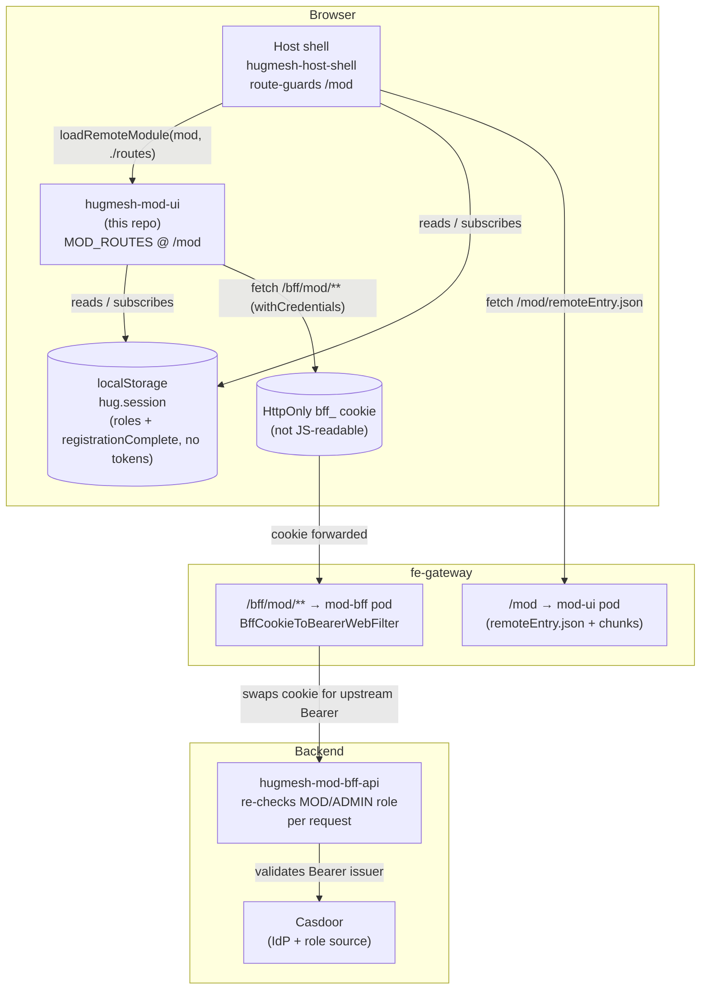
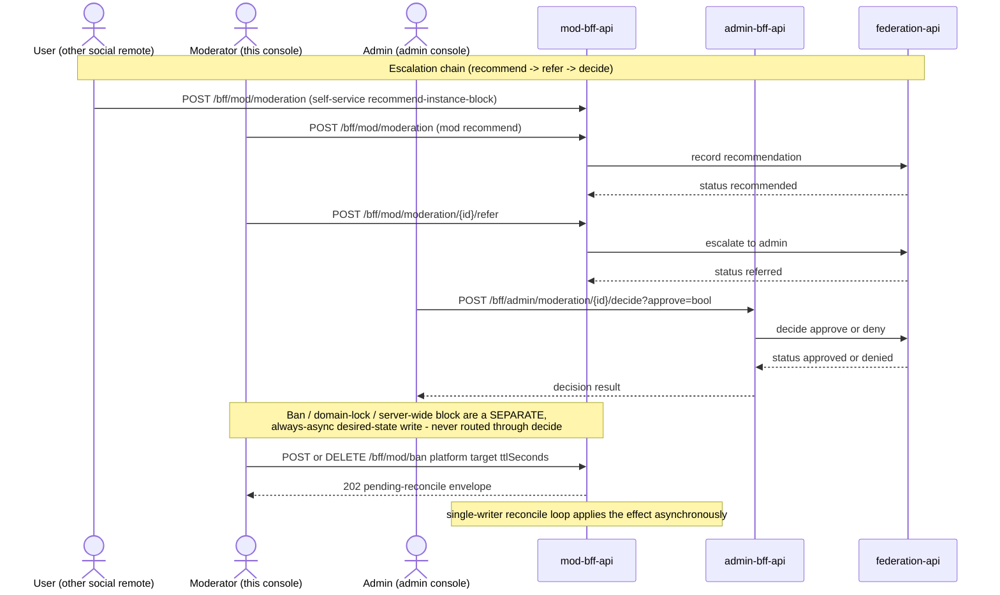

# hugmesh-mod-ui

[](./LICENSE)

The moderator console for the [HugMesh](https://github.com/hugmesh) platform — an Angular 22
**native-federation remote** that ships the moderation queue, findings triage, ban / domain-lock /
server-wide-block controls, and audit trail used by platform moderators. It's the moderator-role
counterpart to [`hugmesh-admin-ui`](https://github.com/hugmesh/hugmesh-admin-ui).

At runtime, [`hugmesh-host-shell`](https://github.com/hugmesh/hugmesh-host-shell) federates
this remote's exposed `MOD_ROUTES` and mounts them at **`/mod`**:

| Host path        | View                   | Component                    |
| ----------------- | ---------------------- | ------------------------------ |
| `/mod`           | Moderator home         | `ModHomeComponent`            |
| `/mod/console`   | Moderation console     | `ModerationConsoleComponent`  |
| `/mod/findings`  | System-findings queue  | `FindingsPanelComponent`      |

Access requires the Casdoor **MOD, ADMIN or SUPERADMIN** role (SUPERADMIN since operator decision 100, 2026-09-23). The host route-guards `/mod` before federating
this remote; the remote also ships its own standalone `modGuard` (applied as `canActivate` on all
three `MOD_ROUTES` entries, so a standalone dev shell gets the same client-side check as the
host-federated build), gating on `SessionService.isMod()` — true for `mod`, `admin` or `superadmin`,
mirroring the backend's `hasAnyRole('MOD','ADMIN','SUPERADMIN')`.

The backend is [`hugmesh-mod-bff-api`](https://github.com/hugmesh/hugmesh-mod-bff-api),
reached same-origin at `/bff/mod/**` through the platform's front-end gateway. Every request
carries the HttpOnly `bff_` session cookie (`withCredentials`, attached by `authInterceptor`) —
the browser never holds a bearer token in JS-reachable storage (see
[Authentication model](#authentication-model)).

## The moderator surface, deliberately narrow

A moderator can triage, escalate, ban, and block server-wide, and can review the automated
edge-AI image-moderation findings queue. There is deliberately **no** infrastructure/server
administration, **no** direct user removal, and **no** appeal adjudication beyond an admin-only
decide control.

The console wires every endpoint the moderator backend actually exposes, and renders anything
without a backing endpoint as **disabled, with explanatory helptext** — defense in depth: the API
is the source of truth, and the UI mirrors its gates rather than hiding controls or failing with a
403 on click. See [The moderator surface in detail](#the-moderator-surface-in-detail) below for the
full endpoint-by-endpoint breakdown.

## How it fits into HugMesh

This is one of the host shell's per-role, per-service remotes (login / user / mod / admin /
matrix / mastodon / forum / API docs / and more). The diagram below shows how the browser, host
shell, this remote, the gateway, and the backend relate at runtime:



- **Host shell ([`hugmesh-host-shell`](https://github.com/hugmesh/hugmesh-host-shell))** —
  route-guards `/mod` on the MOD/ADMIN role and calls
  `loadRemoteModule({ remoteName: 'mod', exposedModule: './routes' })` to lazy-mount `MOD_ROUTES`.
  Host and remote each hold their **own** `SessionService` over the same `hug.session`
  localStorage key, re-reading on a same-page `hug-session-change` broadcast plus cross-tab
  `storage` events.
- **fe-gateway** — fronts this remote's pod at `/mod` (serving `remoteEntry.json` + chunks) and
  same-origin-proxies `/bff/mod/**` to the mod backend. Every request carries the HttpOnly `bff_`
  session cookie (`withCredentials`); the gateway's `BffCookieToBearerWebFilter` swaps it for an
  internal Bearer token server-side.
- **Backend ([`hugmesh-mod-bff-api`](https://github.com/hugmesh/hugmesh-mod-bff-api))** —
  the source of truth: it re-checks the MOD/ADMIN role and gates every endpoint server-side (the
  UI mirrors those gates rather than trusting itself).
- **Multi-tenancy** — this remote is **tenant-agnostic**: it holds no domain/issuer/brand code.
  Per-brand domain scoping is enforced **upstream** (the gateway and backends key off the issuer
  carried in the session/custody token), so the same built remote serves every brand and trusts
  the gateway/backend to scope its data.

### Authentication model

This remote never talks to Casdoor and never sees a raw JWT. Login is a native form POST handled
by the `login-ui` remote against its own backend — the browser is never redirected to a
Casdoor-hosted page; the user-facing backend performs the Casdoor exchange server-side (Casdoor is
internal-only) and holds per-session JWT custody/refresh.

The browser holds only an **HttpOnly `bff_`-prefixed session cookie** — not JS-readable, and not
stored in `hug.session` localStorage (`SnapSession` carries only non-secret metadata: `id`,
`label`, `provider`, `roles`, `registrationComplete`). A moderator never sees their own Casdoor JWT
or a bearer token their own JS could exfiltrate.

The gateway is a pure Casdoor-JWT OAuth2 resource server: a pre-security exchange filter
(`BffCookieToBearerWebFilter`) swaps the `bff_` cookie for the internal custody JWT so the
gateway's JWT validation and role gate run unchanged, and authorization is data-driven by a
`gateway_route_access` table (ADMIN / GAME-MASTER bypass within their own domain, SUPERADMIN
cross-domain). From this UI's perspective this is transparent: `authInterceptor` attaches
`withCredentials` to every `HttpClient` request the generated API client makes to `/bff/mod/**`,
and the platform resolves identity and role upstream.

## The moderator surface in detail

**Wired** (mod backend endpoints, all via the generated, typed `ModeratorService`):

- **Moderation queue + status filter** — `GET /bff/mod/moderation?status=` (the federation queue;
  the filter surfaces user-submitted **`self-silence-appeal`** rows alongside the
  recommended/referred/approved/denied lifecycle).
- **Refer to admin** — `POST /bff/mod/moderation/{id}/refer` (escalate; the only removal path a
  moderator has — a moderator never removes a user directly).
- **Recommend** — `POST /bff/mod/moderation` (`{kind: instance-block|user-removal, target,
  reason?}`) — record a moderator→admin recommendation into the federation queue.
- **Ban / lift** — `POST` / `DELETE /bff/mod/ban` (`{platform: matrix|mastodon|profile, target,
  ttlSeconds?, reason?, idempotencyKey?}`). An empty `ttlSeconds` means **permanent**; the endpoint
  returns `202 {state:'pending-reconcile'}` — the effect applies asynchronously via a
  single-writer reconcile loop, never as a synchronous success.
- **Domain-lock** — `POST` / `DELETE /bff/mod/domain-lock/{role}/{user}` (role ∈
  `ROLE_MATRIX_DOMAINLOCKED`|`ROLE_MASTODON_DOMAINLOCKED`, optional `{reason?, idempotencyKey?}`
  body) — force a user **local-only** (an additive marker that keeps their access, just scoped to
  one domain). Same `202 pending-reconcile` contract.
- **Server-wide block** — `POST /bff/mod/block` (`{platform: matrix|mastodon, scope:
  user|instance, target, reason?}`). Every action is always locally audited, and the external
  result is surfaced honestly — the two platforms differ:
  - The **Matrix (tuwunel) leg is permanently stubbed by design**: tuwunel is Conduit-family and
    has no HTTP admin API at all (only async `!admin` room commands, with no re-activate verb), so
    `blockUser`/`blockInstance` always return `STUBBED`, never `OK`.
  - The **Mastodon (akkoma) leg is wired** to real `pleroma-admin` verbs (confirmed shapes:
    `PATCH .../users/deactivate`, `DELETE .../instances/{host}`) but ships **dark by default**
    behind `external.mastodon.enabled` (unset ⇒ `STUBBED`, no HTTP issued); when enabled, a
    breaker trip or non-2xx response degrades honestly to `degraded:...`, never a false `OK`.
- **Audit trail** — `GET /bff/mod/audit` (the local mod-action audit table), with an opt-in
  **`?mine`** toggle ("only my own actions"); default is OFF, showing the full domain-scoped trail
  (every same-tenant moderator's actions).
- **System-findings queue** — `GET /bff/mod/findings?status=` (the automated edge-AI
  avatar/image-moderation queue, scoped server-side to the caller's issuer domain) and
  `POST /bff/mod/findings/{id}/resolve?actioned=<bool>` to confirm (`actioned`) or dismiss a held
  finding. Surfaced at `/mod/findings` via `FindingsPanelComponent`.

**Admin-only**, wired via `AdminBffService`
([`hugmesh-admin-bff-api`](https://github.com/hugmesh/hugmesh-admin-bff-api), a different
service than the mod backend):

- **Appeals decide (approve/deny)** — `POST /bff/admin/moderation/{id}/decide`. Shown only when
  the caller is an admin (a moderator never decides directly — only escalates via refer, and sees
  the control disabled with helptext instead). A failed or degraded decide is surfaced honestly and
  never renders the row as decided.

**Disabled, with helptext** (verified to have **no** mod/admin backend endpoint):

- **General role grant / revoke** — no endpoint anywhere (role assignment happens at Casdoor via
  the reconcile loop, never as a direct UI grant).
- **External-client grant** — no endpoint (external-client linking is user owner-scoped
  self-service in the user backend; neither the mod nor admin backend grants it).

These controls use `aria-disabled` (not native `disabled`) so they stay keyboard-focusable, and a
screen reader reads the `aria-describedby` helptext explaining **why**.

**Accessibility and messaging:** a queue target shown by name is announced via the shared
`accessibleName()` helper (the ASCII `screenReaderName` when present, degrading to the display name
otherwise — `accessible-name.ts` mirrors the backend's `ScreenReaderNames` printable-ASCII rule,
copied byte-for-byte per remote since native-federation forbids a shared runtime import). Each form
pairs a `role="alert"` validation region with a `role="status"` outcome region: write results are
surfaced as honest async `pending reconcile` notes, with a `(degraded: …)` note when the admin
backend's breaker is open. There is **no** moderator-facing SSE stream on this remote — the mod
backend exposes no SSE endpoint of its own (platform-level SSE has shipped elsewhere — e.g. a
user-facing own-notification stream and a couple of admin job-progress streams — but none of it is
mod-scoped) — so the queue and findings list refresh on demand (poll-on-action).

All data access goes through `ModBffService` — an RxJS `BehaviorSubject`-backed datastore (the
moderation queue, audit trail, and findings queue are cached subjects so every view observes one
source of truth, and a mutation refreshes the cache). The HTTP transport is the generated, typed
`ModeratorService` ([ng-openapi-gen](https://github.com/cyclosproject/ng-openapi-gen)) that
`ModBffService` delegates to; the HttpOnly `bff_` session cookie is attached by the
`authInterceptor` wired in `bootstrap.ts` (`withCredentials: true`) — the browser itself never
holds a bearer token.

### How a failed write is reported

Reads fail soft: a non-2xx `loadModeration` / `loadAudit` / `loadFindings` resolves to `[]`.

Writes do not. Every write (`refer`, `recommend`, `block`, `ban`, `lift`, `domainLock`,
`domainUnlock`, `resolveFinding`) resolves to a **`ModWriteResult`** — `{ok: true, value}` or
`{ok: false, error}` — and never throws. The `error` is a `ModWriteError`
(`src/app/mod-write-error.ts`) carrying:

| field | what it is |
| --- | --- |
| `status` | the HTTP status, or **`0`** when no response reached the browser at all |
| `statusText` | the reason phrase, when there was one |
| `body` | the response body as delivered (parsed object, or raw text) |
| `serverMessage` | the sentence dug out of that body, or `null` |
| `stepUpSignal` | the `X-Step-Up-Required` header value, when present |

`describeWriteFailure()` turns one into the sentence the console announces, under a single rule:
**never assert a reason the client cannot know.** A 403 with no body is announced as a refusal at
that status with the privileged/self-target rule offered as a *possibility*; a 5xx or a status-0
drop says the write may or may not have applied and points at the audit trail; an HTML body is
named as a gateway interstitial rather than treated as an API reason, and the hint is withheld
because it cannot explain a refusal that never reached the moderation service. The
`X-Step-Up-Required` clause is rendered on **whatever** status carried it — 401 and 428
Precondition Required included — not only on 403.

> **Do not trust `statusText`.** HTTP/2 and HTTP/3 carry no reason phrase, so `xhr.statusText` is
> `''` for every response, and Angular's XHR backend substitutes a literal — `xhr.statusText || 'OK'`
> (`@angular/common/fesm2022/_module-chunk.mjs:1649`), or `'Unknown Error'` on a transport failure
> (`:1717`); its fetch backend (`:829`) passes the empty string through. `bootstrap.ts` calls
> `provideHttpClient(...)` with no `withFetch()`, and in production the host shell picks the backend,
> so both are live. Trusting it renders the self-contradicting `HTTP 403 OK`, and — worse — stops
> `serverMessage` matching the reason phrase, so Spring's default
> `{timestamp,status,error:"Forbidden",path}` envelope gets echoed as if it were an explanation,
> which suppresses the hint. `mod-write-error.ts` therefore derives the displayed phrase, and the
> phrase it compares a message against, from `REASON_PHRASES[status]` — not from the wire.

This replaced a `.catch(() => null)` on all seven write paths, which made a step-up 403, an
expired session, a gateway 502 and an offline browser indistinguishable — the console announced
all of them as *"you cannot ban yourself or a moderator/administrator"*. It is also the
prerequisite for the MFA step-up port (see Roadmap, and #14 / #1).

### Moderation action lifecycle

Two distinct write patterns live in this console. The escalation chain (recommend → refer →
decide) is a synchronous request/response all the way through, ending in an admin's explicit
approve/deny. The access-control writes (ban/lift, domain-lock, server-wide block) are always an
asynchronous `202-pending-reconcile`, applied later by the backend's single-writer reconcile loop —
this UI never claims a synchronous success for those:



A moderator never calls the admin decide endpoint directly (it renders disabled, with helptext,
for them) — `refer` is the only escalation path a moderator has; only an admin's explicit `decide`
applies or reverses a moderation action.

## Generated API client (ng-openapi-gen)

[`ng-openapi-gen`](https://github.com/cyclosproject/ng-openapi-gen) is configured
(`ng-openapi-gen.json`: `input: openapi.json` → `output: src/app/api`, `skipJsonSuffix`,
`enumStyle: alias`) with two npm scripts:

```bash
npm run gen:spec     # copy mod-bff openapi.json → ./openapi.json, then ng-openapi-gen
npm run gen          # ng-openapi-gen against the existing committed openapi.json
```

`gen:spec` copies the OpenAPI spec from a sibling `../hugmesh-mod-bff-api` checkout
(`src/main/resources/openapi/openapi.json`; override the source path with the `MOD_BFF_SPEC` env
var if your checkout lives elsewhere) into `./openapi.json`, then runs `gen`. `gen` regenerates the
client from the committed `openapi.json` alone, with no network access required. Output lands in
`src/app/api`, per `ng-openapi-gen.json`.

Both `openapi.json` and the generated `src/app/api` client (including `services/moderator.service.ts`,
`models/*`, `fn/moderator/*`) are committed to the repo, and `ModBffService` **delegates** every
call to the generated, typed `ModeratorService` (`inject(ModeratorService)`) instead of
hand-rolling `fetch`. The generated client calls the same same-origin `/bff/mod/**` paths; the
HttpOnly `bff_` session cookie is attached by the `authInterceptor` wired in `bootstrap.ts`, so
wire behavior is unchanged. `ModBffService` keeps its own public request/response types and bridges
the backend's envelopes at the delegation boundary.

## Module federation

`federation.config.js` exposes `./routes` (mapped to `src/app/mod.routes.ts`, exporting
`MOD_ROUTES`) under the native-federation remote name **`mod`**. The shared-dependency surface and
RxJS skip list are defined in `federation-base.js`, which mirrors the admin remote's base config.
The build emits `dist/mod/browser/remoteEntry.json`; the host reads that file's `exposes` map to
lazy-load `MOD_ROUTES` at runtime.

## Getting started

### Prerequisites

- Node.js >= 24.15 (Angular CLI 22 requirement)
- A reachable `hugmesh-mod-bff-api` instance for anything beyond the standalone client-side checks
  (see [Develop](#develop) below)

### Develop

```bash
npm install
npm start            # ng serve mod → http://localhost:4205 (standalone dev shell)
```

The standalone dev shell (`AppComponent`, selector `hug-mod-root`) mounts `MOD_ROUTES` at `/`,
making the remote browsable without the host shell. In production the host federates `./routes`
directly; this shell is not loaded there.

The dev server expects the mod backend to be reachable. `ModBffService` delegates to the generated
`ModeratorService`, whose `ApiConfiguration.rootUrl` defaults to same-origin (empty string), which
only works behind the fe-gateway. For standalone dev without the gateway, override `rootUrl` (e.g.
via a DI provider or the browser console) before the app bootstraps, or run the full stack via the
kind dev-overlay recipe documented in
[`hugmesh-generator`](https://github.com/hugmesh/hugmesh-generator).

| Dev URL                          | View                   |
| --------------------------------- | ---------------------- |
| `http://localhost:4205/`         | Moderator home         |
| `http://localhost:4205/console`  | Moderation console     |
| `http://localhost:4205/findings` | System-findings queue  |

### Build

```bash
npm run build        # ng build mod
```

The Angular application builder nests output under **`dist/mod/browser/`** (including
`remoteEntry.json`).

### Test

```bash
npm test             # ng test mod --watch=false --browsers=ChromeHeadlessCI
```

Karma/Jasmine cover every component, service, guard, and the federation-contract routes. The
`ChromeHeadlessCI` launcher runs with `--no-sandbox --disable-dev-shm-usage` for CI environments.

A Playwright + BDD (Gherkin) end-to-end harness also ships in `e2e/` — see
[`e2e/README.md`](e2e/README.md) for the full scenario catalogue and how to run it offline (no live
cluster required) versus against a live stack.

## Deployment & CI

`Dockerfile` builds the remote and serves `dist/mod/browser` via nginx with
`Access-Control-Allow-Origin "*"` (so a host shell can fetch `remoteEntry.json` and chunks
cross-origin) and an SPA fallback to `/index.html`; `GET /healthz` returns `200`. `nginx.conf` also
emits a baseline set of defense-in-depth security headers on every response, including error
responses: `X-Content-Type-Options: nosniff`, `X-Frame-Options: DENY`,
`Referrer-Policy: strict-origin-when-cross-origin`, and `Strict-Transport-Security`
(`max-age=31536000; includeSubDomains`). These are safe defaults for an Angular SPA plus
module-federation remotes plus OAuth redirect flows; a stricter `Content-Security-Policy` /
COEP-CORP / `Permissions-Policy` set needs per-deployment tuning and is left to the operator.

The primary pipeline is GitLab CI (`.gitlab-ci.yml`), with four stages:

- **test** — runs `npm test` (Karma, headless Chromium) and publishes a JUnit report
  (`test-results/results.xml`, via `karma-junit-reporter`) so individual test results surface in
  merge request widgets.
- **e2e** — `e2e:bdd` runs the Gherkin harness's codegen and a `--list` compile/discovery check.
  It executes **no scenarios** by default: every `.feature` file is tagged `@cluster` at the
  feature level, and the default Playwright config filters on `tags: 'not @cluster'`, so the
  runnable set is empty until a live cluster is available. The job is `allow_failure: true`
  (non-blocking) and proves only that the harness installs, the Gherkin compiles, and every
  scenario is discoverable. See [`e2e/README.md`](e2e/README.md) for how to un-skip a feature.
- **build** — builds and pushes the container image to the project's container registry, tagged
  with the release tag or git SHA plus a moving branch tag.
- **pentest** — a non-blocking OWASP pen-test stage, included from the centralized
  `pentest-stage.gitlab-ci.yml` in [`hugmesh-generator`](https://github.com/hugmesh/hugmesh-generator),
  running `pentest:sca` (Dependency-Check SCA) and `pentest:dast` (an authenticated ZAP baseline
  scan plus nuclei). Both are `allow_failure: true` and run on the default branch and merge
  requests, so a finding surfaces in the MR widget without breaking the pipeline.

A manual-dispatch GitHub Actions workflow (`.github/workflows/release.yml`) is also available to
build and publish the image to GHCR (`ghcr.io/hugmesh/hugmesh-mod-ui`) directly from GitHub —
useful if you're building from a fork or don't have access to the project's primary CI. It's
inert until triggered from the Actions tab; it doesn't run on every push.

### Local security testing

`Makefile` mirrors the CI pen-test posture for local use:

```bash
make pentest          # SCA (npm audit) + DAST (if DAST_TARGET_URL is set)
make pentest-sca      # npm audit only
make pentest-dast     # DAST against $DAST_TARGET_URL, delegating to the hugmesh-generator harness
```

Tunables: `NPM_AUDIT_LEVEL` (default `high`), `DAST_TARGET_URL` (unset ⇒ DAST is skipped),
`PENTEST_HARNESS_DIR` (default `../hugmesh-generator/tests/pentest`), `PENTEST_SCAN`
(`baseline` or `full`, default `baseline`). The DAST target delegates to the shared harness in
[`hugmesh-generator`](https://github.com/hugmesh/hugmesh-generator) — clone it as a sibling
checkout to use `make pentest-dast` locally.

## Project status

- **Shipped:** the three moderator views (home, console, system-findings queue); the full wired
  mod-backend surface (queue + filter, refer, recommend, ban/lift, domain-lock, server-wide block,
  audit, findings list + resolve); the admin-only decide control; the two disabled-with-helptext
  controls; the shared `accessibleName()` / alert+status accessibility pattern; full keyboard
  navigation; Karma unit coverage with JUnit reporting; the four-stage test/e2e/build/pentest
  GitLab pipeline; and the baseline nginx security headers.
- **`modGuard` is applied to every route** — all three `MOD_ROUTES` entries
  (`src/app/mod.routes.ts`) set `canActivate: [modGuard]`, so the standalone dev shell gets the
  same client-side role check as the host-federated build, for `/mod`, `/mod/console`, and
  `/mod/findings` alike. This is defense-in-depth only — the mod backend still re-checks the
  MOD/ADMIN role server-side and remains the authoritative gate.
- **Authentication model:** native `login-ui` form POST against its own backend (no Casdoor
  browser redirect; Casdoor is internal-only) handled server-side; the user-facing backend holds
  JWT custody. The browser holds only an **HttpOnly `bff_` session cookie** — not JS-readable and
  not present in `hug.session` localStorage (which carries only `id`/`label`/`provider`/`roles`/
  `registrationComplete`, no tokens). `authInterceptor` attaches `withCredentials` to outgoing
  `/bff/mod/**` requests; the gateway's `BffCookieToBearerWebFilter` swaps the cookie for the
  internal custody JWT and enforces role/route access. This remote is a tenant-agnostic Angular
  application with no backend coupling beyond the mod-backend contract.
- **Typed API client (shipped):** `ng-openapi-gen` is configured, and both `openapi.json` and the
  generated `src/app/api` client are committed; `ModBffService` delegates every call to the
  generated, typed `ModeratorService` (no hand-written `fetch`).

## Roadmap

- 🔭 **Wire the remaining `@cluster` e2e scenarios into CI** — promote the live-cluster-only
  Playwright + BDD scenarios into the pipeline once a cluster is available to the runner.
- 🔭 **MFA / step-up awareness — both halves are merged; arming the gate and a human-driven
  challenge are what is left.**
  Platform-wide MFA has shipped (Casdoor TOTP enroll/challenge, a session-level `MFA_SATISFIED`
  authority, and a step-up dialog already live in `login-ui` and `hugmesh-admin-ui`), and
  hugmesh-mod-bff-api gates this console's five sensitive writes (`POST /block`,
  `POST|DELETE /ban`, `POST|DELETE /domain-lock/{role}/{user}`) with `ModStepUpGate` behind the
  dark-by-default `app.mfa.enforce-sensitive-writes` (`application.yml` there).
  **What this remote has** (#1, PR #17): `src/app/mfa/` — a detection predicate over `ModWriteError`
  (`step-up-error.ts`), a trimmed `MfaService` for `POST /bff/mfa/challenge` +
  `POST /bff/mfa/assert/webauthn/options`, and `MfaStepUpDialogComponent` ported from admin-ui.
  The moderation console opens it inline under the refused form and re-issues the SAME request
  snapshot once the challenge succeeds; cancelling says plainly that nothing was applied, and
  closing it because the deployment has MFA switched off says to escalate rather than to retry.
  The dialog is inline, not modal, so the other forms stay live while one write is stalled: AT MOST
  ONE challenge is open at a time — a second gated write is refused with a message naming the one
  to finish first, rather than silently displacing it.
  **The denial signal has shipped in mod-bff** (hugmesh-mod-bff-api#16, PR #18):
  `ModStepUpAccessDeniedHandler` (wired in `SecurityConfig`) answers an armed-gate refusal with a
  403 carrying `X-Step-Up-Required: X-Mod-StepUp` and a body containing `requires step-up`, which are
  the two legs `isStepUpRequiredError` matches. A bare 403 (the privileged-target, self-target and
  cross-tenant rules) is still an ordinary refusal and does not open the dialog. The loop is proven
  against a mocked mod-bff by `e2e/features/moderation/mfa-step-up-mocked.feature` (PR #19), which
  runs without a cluster.
  The seam that made the UI half writable was #14/#15: `ModBffService` no longer collapses write
  failures to `null`, so every write resolves to a `ModWriteResult` carrying the HTTP status, the
  response body and the `X-Step-Up-Required` header.
  **What is still open:**
  - The gate ships dark. Nobody sees a challenge until a deployment sets
    `app.mfa.enforce-sensitive-writes=true` and `app.casdoor.mfa.enabled=true`; an operations
    toggle, not a change in this repo.
  - **Not yet exercised by a human** — the dialog has unit coverage and the mocked e2e loop;
    nothing has driven a real Casdoor challenge from this console. That check stays a manual
    test on a live mesh (#1).
  - Some code comments and the unit spec in `moderation-console.component.spec.ts` still describe
    the dialog as INERT against a server that sends a bare 403; they predate PR #18 and are due
    a refresh.

- 🔭 **Server-wide block, real backend for Mastodon** — the Mastodon (akkoma) leg is already wired
  to confirmed `pleroma-admin` verbs but ships dark by default behind
  `external.mastodon.enabled`; flipping it on in a given deployment is an operations task, not a UI
  change (this console already surfaces the honest `external` outcome either way). The Matrix
  (tuwunel) leg is stubbed by architecture — no admin REST API exists on that homeserver — so it
  won't become real without a different Matrix homeserver.
- 🔭 **No shared profile entry point** — `hugmesh-admin-ui` exposes no shared profile remote, so
  there's no existing pattern to mirror here; this remote exposes only its three moderator views.

## Contributing

Issues and pull requests are welcome. A few pointers specific to this repo:

- Run `npm test` before opening a PR — Karma covers every component, service, guard, and the
  federation-contract routes.
- If you touch the API surface, regenerate the client with `npm run gen` (or `npm run gen:spec`
  against a sibling `hugmesh-mod-bff-api` checkout) rather than hand-editing `src/app/api`.
- Keep new write-facing controls consistent with the existing pattern: wire what the backend
  actually exposes, and render anything without a backing endpoint as `aria-disabled` with
  `aria-describedby` helptext rather than hiding it.
- The Playwright/BDD suite in `e2e/` is the place for new cross-role or cross-user scenarios; see
  [`e2e/README.md`](e2e/README.md) for the tagging convention that keeps cluster-dependent
  scenarios out of the default run.

For platform-level changes (new backend endpoints, shared federation config, CI templates), see
the related repositories below — most cross-cutting conventions live in
[`hugmesh-generator`](https://github.com/hugmesh/hugmesh-generator).

## Related HugMesh repositories

| Repository | Role |
| --- | --- |
| [`hugmesh-host-shell`](https://github.com/hugmesh/hugmesh-host-shell) | Host application that federates every per-role/per-service remote, including this one |
| [`hugmesh-admin-ui`](https://github.com/hugmesh/hugmesh-admin-ui) | Admin-role counterpart remote (decide, infra/server administration) |
| [`hugmesh-mod-bff-api`](https://github.com/hugmesh/hugmesh-mod-bff-api) | Backend-for-frontend this console talks to at `/bff/mod/**` |
| [`hugmesh-admin-bff-api`](https://github.com/hugmesh/hugmesh-admin-bff-api) | Backend-for-frontend behind the admin-only decide control |
| [`hugmesh-generator`](https://github.com/hugmesh/hugmesh-generator) | Shared CI templates, pen-test harness, and platform dev-cluster tooling |

See the [hugmesh](https://github.com/hugmesh) organization for the rest of the platform.

## License

[MIT](./LICENSE)
